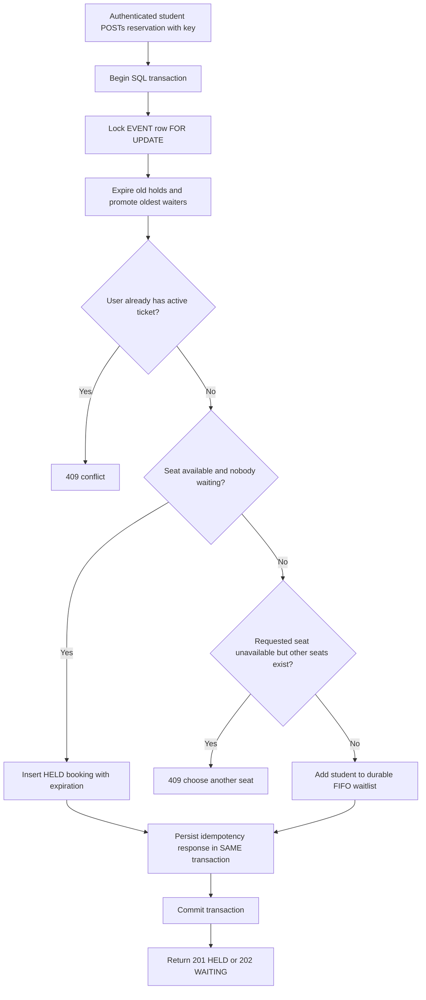

# Data model and workflow diagrams

Mermaid is supported by GitHub and many Markdown renderers.

## Entity relationship diagram (ERD)

```mermaid
erDiagram
  USERS ||--o{ BOOKINGS : creates
  USERS ||--o{ WAITLIST : joins
  USERS ||--o{ PAYMENT_ATTEMPTS : requests
  USERS ||--o{ IDEMPOTENCY_KEYS : owns
  EVENTS ||--|{ SEATS : has
  EVENTS ||--o{ BOOKINGS : receives
  EVENTS ||--o{ WAITLIST : maintains
  EVENTS ||--o{ BOOKING_AUDIT : records
  SEATS ||--o{ BOOKINGS : allocated_in_history
  BOOKINGS ||--o{ PAYMENT_ATTEMPTS : attempts
  BOOKINGS ||--o{ BOOKING_AUDIT : changes
  BOOKINGS o|--o{ WAITLIST : offered_to
  USERS {
    bigint id PK
    text email UK
    text password_hash
  }
  EVENTS {
    bigint id PK
    text slug UK
    text title
    timestamptz starts_at
  }
  SEATS {
    bigint id PK
    bigint event_id FK
    int number
  }
  BOOKINGS {
    uuid id PK
    bigint event_id FK
    bigint seat_id FK
    bigint user_id FK
    text status
    timestamptz hold_expires_at
  }
  WAITLIST {
    uuid id PK
    bigint event_id FK
    bigint user_id FK
    uuid offered_booking_id FK
    text status
    timestamptz joined_at
  }
  PAYMENT_ATTEMPTS {
    uuid id PK
    uuid booking_id FK
    bigint user_id FK
    text outcome
    text status
    timestamptz ready_at
  }
  IDEMPOTENCY_KEYS {
    bigint user_id PK,FK
    text scope PK
    text key PK
    text request_hash
    jsonb response_body
  }
  OUTBOX {
    bigint id PK
    text event_type
    jsonb payload
    timestamptz published_at
  }
  BOOKING_AUDIT {
    bigint id PK
    bigint event_id FK
    uuid booking_id FK
    bigint actor_user_id FK
    text action
    jsonb details
  }
```



**Most important constraints:** `unique_active_seat` and
`unique_active_ticket_per_user` are PostgreSQL *partial unique indexes*.
The database does not allow two `HELD`/`CONFIRMED` rows to use the same seat
or the same user to own multiple active tickets to one event.

## Seat reservation and waiting queue



## Payment worker sequence

```mermaid
sequenceDiagram
  participant U as Student
  participant API as FastAPI
  participant PG as PostgreSQL
  participant PUB as Publisher
  participant MQ as RabbitMQ
  participant W as Consumer / Scanner
  U->>API: POST payment with Idempotency-Key
  API->>PG: Lock event, validate hold, insert PENDING payment + outbox
  PG-->>API: Commit all three pieces atomically
  API-->>U: 202 PENDING (payment ID)
  PUB->>PG: SELECT outbox FOR UPDATE SKIP LOCKED
  PUB->>MQ: Publish persistent PAYMENT_REQUESTED
  MQ-->>PUB: Confirm
  PUB->>PG: Mark outbox row published
  MQ->>W: Deliver payment message
  W->>PG: Lock event and check payment/hold
  alt ready and hold valid, simulated success
    W->>PG: CONFIRMED booking + SUCCEEDED payment + audit
  else failed or expired
    W->>PG: FAILED/TIMED_OUT and promote next waiter
  else delayed and not ready
    W->>PG: Leave PENDING; scanner processes later
  end
  W-->>MQ: Ack message after DB commit
  U->>API: GET payment status
  API->>PG: Read owned payment
  API-->>U: SUCCEEDED / FAILED / PENDING / TIMED_OUT
```

### Concurrency timeline, same seat

```mermaid
sequenceDiagram
    participant A as Student A
    participant B as Student B
    participant DB as PostgreSQL
    A->>DB: BEGIN + lock EVENT row
    B->>DB: BEGIN + wait on same EVENT lock
    A->>DB: Check seat free, INSERT HELD
    A->>DB: COMMIT
    DB-->>B: Event lock acquired
    B->>DB: Check seat again, see A's HELD row
    B->>DB: 409 or queue; no second hold
    B->>DB: COMMIT
```
