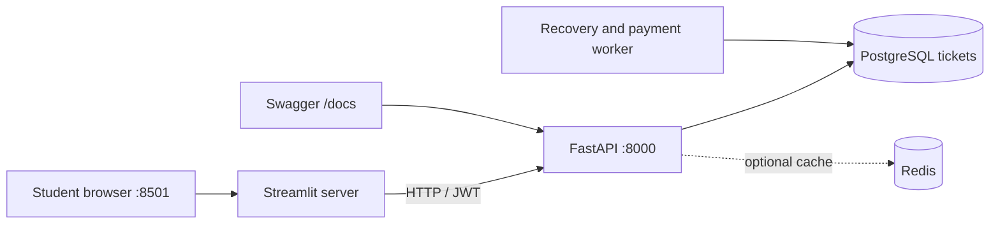

# Student portal + improved Swagger · Windows setup

**Version 1.3 · Streamlit usability update**. The PostgreSQL schema has not changed. This UI uses existing FastAPI endpoints, so all concurrency, expiry, idempotency, queue and payment rules stay in the backend.

## URLs and three terminals

| URL | Purpose |
|---|---|
| `http://127.0.0.1:8000/docs` | Developer-friendly Swagger explorer, grouped routes, samples and guide |
| `http://127.0.0.1:8000/redoc` | Read-only API reference |
| `http://127.0.0.1:8501` | Streamlit student portal |
| `http://127.0.0.1:8000/health/ready` | PostgreSQL readiness |

### First-time install (Python 3.13)

You already have PostgreSQL 18 and your existing `tickets` database. **Do not rerun the SQL seed or schema files**.

Open PowerShell in `C:\Users\hamza\Downloads\the last seat` (or wherever you extracted the project):

```powershell
py -3.13 -m venv .venv313   # skip if this environment already exists
.\.venv313\Scripts\python.exe -m pip install -r requirements.txt
.\.venv313\Scripts\python.exe -m pip install -r frontend\requirements.txt
```

For a **patch installation**, extract the add-on ZIP **into your project root** (the folder containing `app`, `worker`, `db`); select overwrite for `app/main.py` and `app/schemas.py` only. The patch does not touch your database, `loadtests/race.js`, `.env` or test results.

### Every time you start (3 PowerShell windows)

Run each command from the project root. All scripts prompt for passwords **where necessary** and keep them in process memory, not in files.

**Window 1 · FastAPI**

```powershell
powershell -ExecutionPolicy Bypass -File .\scripts\start_api_windows.ps1
```

Expect `Application startup complete`. Check `http://127.0.0.1:8000/docs`.

**Window 2 · Payments + expiry worker**

```powershell
powershell -ExecutionPolicy Bypass -File .\scripts\start_worker_windows.ps1
```

The worker stays running and may not print anything while idle. It uses PostgreSQL reconciliation without RabbitMQ. Redis is turned off in these Windows scripts.

**Window 3 · Streamlit**

```powershell
powershell -ExecutionPolicy Bypass -File .\scripts\start_frontend_windows.ps1
```

Open `http://127.0.0.1:8501`. Your browser should display The Last Seat student portal.

The browser-facing portal does not require any PostgreSQL credentials. Its local server makes HTTP calls to FastAPI via `httpx`.

### Walkthrough

1. Select **Explore seats** and an event. Choose a 50-seat section, then click any available numbered seat to request an immediate hold.
2. Register or sign in. Existing test accounts can use **Sign in**, not **Create an account**.
3. Click an available numbered seat to reserve it directly, or select **Reserve best available seat**.
4. `201`: hold created; open **My Tickets**. `202`: waitlisted; open **Waitlist**.
5. In My Tickets, choose **success**, **failure**, or a delayed payment simulation. The worker completes the payment.
6. Refresh booking/payment status and inspect the audit trail. Confirmed holds can be cancelled (simulated refund).
7. Use **System status** to view the latest live integrity report.

**Why seats can appear available yet fail:** The seat map is a read-only snapshot. Another student may reserve first. FastAPI and PostgreSQL always make the final decision.

**Why payments may stay pending:** The background worker needs to be running. Delayed outcomes naturally take longer. Expired holds cannot be confirmed later.

**Why the portal asks you to sign in again:** JWTs last 12 hours. The Windows startup helper also creates a new temporary JWT secret every time FastAPI restarts, so tokens from older server sessions become invalid.

**Why queue IDs matter:** The API has `GET /waitlist/{id}` but no list-all-my-waitlist-entries endpoint. The portal remembers the current ID in `st.session_state` and allows manual re-entry after a browser/session restart.

### Quick read-only health check

In a fourth PowerShell window, run:

```powershell
powershell -ExecutionPolicy Bypass -File .\scripts\check_ui_windows.ps1
```

This checks both HTTP ports and the new Swagger banner without writing to PostgreSQL.

### Developer check and new tests

```powershell
.\.venv313\Scripts\python.exe -m pytest tests\test_frontend_client.py -v
# Optional full regression, set the same TEST_DATABASE_URL and RUN_INTEGRATION=1 as before.
```

Do not interpret a screenshot of the Streamlit app as a load-test result. The 10,000-attempt k6 evidence applies to the FastAPI backend and its PostgreSQL database.

## Architecture



Streamlit does not access SQL tables and never replaces the FastAPI booking rules. The backend Docker Compose and Nginx bonus paths remain available separately.

## Usability and security limitations

- The Streamlit app is designed for **local development and demos**, not public Internet deployment. Add HTTPS, stronger session handling and an identity provider before production use.
- JWT is stored only in Streamlit's session state; never display, log or publish it.
- This is a **payment simulator**, not a payment gateway. No payment credentials are collected.
- A fresh idempotency key is created for every click. If the network times out, **check booking history before retrying**. There is no durable retry-key store in this UI.
- The Swagger stylesheet is local, but Swagger's JavaScript assets still use FastAPI's default CDN links; without Internet access, `/docs` may not render. `/openapi.json` and Streamlit remain available.
- Seat numbers use native, accessible Streamlit buttons in 50-seat pages. Disabled seats are unavailable. The buttons invoke FastAPI and never reserve seats locally.
- Keep the worker running; otherwise holds and payments can remain pending until a later reconciliation.
- The schema, PostgreSQL privileges and tested database indexes are untouched.

## Troubleshooting

| Symptom | First check |
|---|---|
| `ModuleNotFoundError: streamlit` | Install `frontend/requirements.txt` into `.venv313` |
| `API offline` in sidebar | FastAPI is running at port 8000 and `/health/ready` returns `ready` |
| `401` after restart | Sign out and sign in again; the API may have a new JWT secret |
| Payment never completes | Start the background worker window; check its logs |
| Seat map shows old state | Click Refresh availability; cache setting may also apply |
| `psycopg-binary` resolution error | Use standard Python 3.13 as in the verified Windows environment |
| Port 8501 occupied | Close the other Streamlit process or change the port in the helper |

## v1.3 extras

- **Sign out** is visible in the main page header and near the top of the sidebar after login.
- The sidebar attribution footer was removed.
- Test and load-test events are hidden by default from the student-facing selector. Enable **Show temporary test events** when needed.
- `scripts/cleanup_test_event.py` previews and deletes an explicitly selected test event with safety guards. See `docs/V1_3_UI_AND_CLEANUP.md`.
